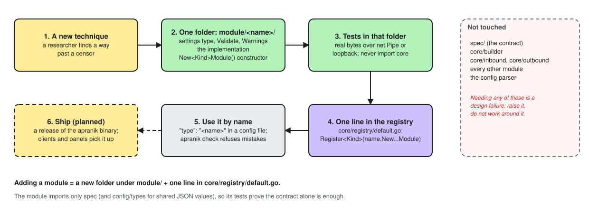

# Apranik

[](https://github.com/we-apranik/apranik/actions/workflows/ci.yml)
[](LICENSE)
[](go.mod)

**Censorship adapts. So we must.**

Apranik is a modular proxy platform infrastructure for circumvention. A new way around censorship is added once, as a module, and ships to every client app and server panel built on it. Open source, written in Go.

**Documentation: [we-apranik.github.io/apranik](https://we-apranik.github.io/apranik/)**

> [!NOTE]
> Apranik is young and its config format may still change.

## How it works

Apranik is the shared infrastructure underneath the apps. Each part of a connection is its own module, and a new method is another module that plugs into the same place. A researcher adds one without changing the rest, and a maintainer reviews it on its own.

[](docs/assets/diagrams/research-to-deployment.excalidraw.svg)

How the layers fit, and everything already built in, is on the [docs site](https://we-apranik.github.io/apranik/concepts/architecture/).

## Quick start

Requires Go 1.27 or newer. Save this as `config.json`: a local SOCKS5 and HTTP proxy that sends everything straight out.

```json
{
  "version": 1,
  "log": {
    "level": "info",
    "outputs": [{ "type": "stderr", "format": "human" }]
  },
  "inbounds": [
    {
      "tag": "local",
      "listen": "127.0.0.1",
      "port": 1080,
      "transport": [{ "type": "tcp" }],
      "protocol": {
        "type": "mixed",
        "settings": { "socks5": {}, "http": {} }
      }
    }
  ],
  "outbounds": [
    {
      "tag": "direct",
      "protocol": { "type": "freedom" }
    }
  ]
}
```

Build, validate, run and try it:

```sh
git clone https://github.com/we-apranik/apranik.git
cd apranik
go build -o apranik ./cmd/apranik
./apranik check -config config.json
./apranik run -config config.json
curl --socks5-hostname 127.0.0.1:1080 https://example.com/
```

## Documentation

- [Get started](https://we-apranik.github.io/apranik/get-started/overview/)
- [Guides](https://we-apranik.github.io/apranik/guides/): set up a server and a client
- [Configuration reference](https://we-apranik.github.io/apranik/configuration/)
- [Architecture](https://we-apranik.github.io/apranik/concepts/architecture/)

## Contributing

> [!WARNING]
> **Read this first**
>
> Where circumvention is illegal, contributing can put you at risk. You can
> contribute under a pseudonym, and the steps to do it safely are in
> [Contribute safely](https://we-apranik.github.io/apranik/contribute/safety/).
> Do them before your first commit.

Start with [CONTRIBUTING.md](CONTRIBUTING.md) and the [first-module tutorial](https://we-apranik.github.io/apranik/contribute/first-module/). Please follow the [Code of Conduct](CODE_OF_CONDUCT.md). New modules of each kind have their own guides under [Contribute](https://we-apranik.github.io/apranik/contribute/). The docs site is in `docs/`; see [Editing the docs](https://we-apranik.github.io/apranik/contribute/docs/).

## Security

Report vulnerabilities privately, by email. See [SECURITY.md](SECURITY.md) or [how reports are handled](https://we-apranik.github.io/apranik/get-started/security/).

## Licence

[Mozilla Public License 2.0](LICENSE).
