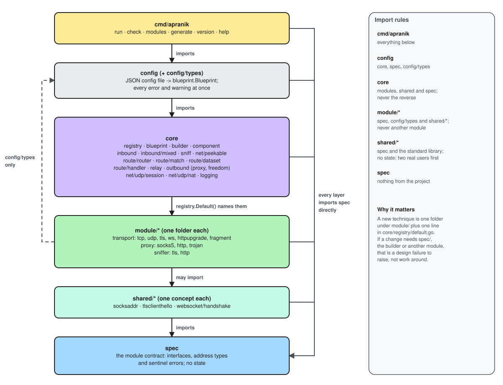

# Architecture

Apranik is four layers. Each one imports only the layers below it, and the
bottom layer, `spec`, imports nothing from the project.

[](assets/diagrams/architecture-overview.excalidraw.svg)


| Layer | Holds | May import |
| --- | --- | --- |
| `spec` | every interface, the address types and the sentinel errors; no state | nothing from the project |
| `module/*` | transports, proxy protocols and sniffers, one folder each | `spec`, and `config/types` for shared JSON values |
| `core/*` | registry, building, routing, relaying, UDP sessions and NAT, logging | `spec` and modules |
| `config` | the JSON config file → `blueprint.Blueprint` | `spec`, `core` |
| `cmd/apranik` | the standalone command | everything above |

## The spec contract

[](assets/diagrams/spec-contract.excalidraw.svg)

[`spec/spec.go`](https://github.com/The-Apranik/Apranik/blob/main/spec/spec.go)
is a single file of declarations. Its main groups:

**Carriers.** There are two, and only two:

- `Stream`: `net.Conn` plus `CloseWrite() error`. Half-close is part of the
  contract; a carrier that cannot signal it returns `ErrNoHalfClose` instead of
  leaving a caller hanging.
- `Datagram`: `ReadFrom` / `WriteTo` with message boundaries kept, addressed by
  `Destination`.

Substrates with no server initiative, such as DNS tunnels or mailbox relays, are
expected to build a `Stream` internally (Decided; none exists yet).

**Addresses.** `Endpoint` is an IP and a port, already resolved. `Destination` is
exactly one of a domain or an IP, plus a port. A domain stays a domain until the
base transport, which is the only layer that resolves.

**Transport kinds.** A base transport creates connections; an overlay wraps them:

| Kind | Methods |
| --- | --- |
| `BaseStreamTransport` | `NewStreamDialer`, `NewStreamListener` |
| `OverlayStreamTransport` | `WrapStreamDialer`, `WrapStreamListener` |
| `BaseDatagramTransport` | `NewDatagramDialer`, `NewDatagramListener` |
| `OverlayDatagramTransport` | `WrapDatagramDialer`, `WrapDatagramListener` |

**Proxy kinds.** Carrier and payload are independent, so there are three shapes:

| Kind | Below (carrier) | Above (payload) | Example |
| --- | --- | --- | --- |
| `StreamProxy` | `Stream` | `Stream` | SOCKS5, HTTP and Trojan CONNECT (implemented) |
| `DatagramOverStreamProxy` | `Stream` | `Datagram` | Trojan UDP (implemented); VLESS planned |
| `DatagramProxy` | `Datagram` | `Datagram` | Shadowsocks UDP (none implemented) |

[](assets/diagrams/proxy-shapes.excalidraw.svg)

A proxy protocol never opens a connection. It is handed a carrier and returns a
carrier ("wrapper, not pump"); core runs the copy loop.

**Sniffer.** `Sniff(payloadPrefix []byte) (SniffResult, error)`, returning
`ErrSniffNeedMoreData` while the bytes so far are only a prefix.

**Core-facing interfaces.** `Metadata` (network, destination, source, inbound
tag, user, sniff result), `Router`, `TrafficHandler`, `Inbound`, `Outbound`, and
`UDPAssociateSocketFunc` for SOCKS5's second socket.

Every module kind embeds `Config` (`Validate() error`, `Warnings() []string`) and
has `Info() ModuleInfo`. The module value *is* its configuration: core decodes the
config file's `settings` straight into it, so `spec` never names a config field.

## Modules

A module is a package under `module/` that exports one constructor per kind it
fills:

```go
func NewBaseStreamTransportModule() spec.BaseStreamTransport // module/transport/tcp
func NewStreamProxyModule() spec.StreamProxy                 // module/proxy/socks5
func NewSnifferModule() spec.Sniffer                         // module/sniffer/tls
```

`core/registry` stores these constructors by name and kind. `registry.Default()`
in `core/registry/default.go` is the only place in the project that names a
module. There is no `init()` and no global registry, so a Go program using Apranik can build a
registry containing modules Apranik has never heard of.

[](assets/diagrams/module-registry.excalidraw.svg)

## Stack composition

A transport stack is written base first, then overlays outward from the wire.
The builder composes it as a fold: it asks the base for a dialer or listener,
then hands that to each overlay's `Wrap*` method. It never needs to know what a
layer is.

[](assets/diagrams/stack-composition.excalidraw.svg)


> [!NOTE]
> No overlay transport exists yet, so today every stack is a single base
> transport and `Wrap*` is never called. TLS is planned as the first real test.

## Shared helper packages

Code several modules need that is not part of the contract lives under
`shared/`, one concept per package. Modules may import these, `spec` and
`config/types`, and never another module. Today there is one:
`shared/socksaddr`, the RFC 1928 address codec used by SOCKS5 and Trojan. See
a design note.

## Core packages

| Package | Responsibility |
| --- | --- |
| `core/registry` | name → module constructor, per kind, with clear errors for a name used in the wrong position |
| `core/blueprint` | a validated description of every inbound and outbound; nothing is opened |
| `core/builder` | blueprint → `spec.Inbound` / `spec.Outbound`; folds stacks; grants the UDP associate socket |
| `core/inbound` | accept loop, handshake timeout, identifying which payload a request asks for, fallback, sniffing, handing a UDP association to the handler |
| `core/sniff` | peeks the start of a stream through `core/net/peekable`, runs sniffers |
| `core/net/peekable` | `spec.PeekableStream`; a recording mode that replays a refused handshake to the fallback |
| `core/route/router` | `spec.Router`; with no rules yet, always the default outbound |
| `core/route/handler` | `spec.TrafficHandler`: asks the router, dials, relays; owns each UDP session and its routing cache |
| `core/relay` | `relay.Stream` copies both ways and carries half-close; `relay.Datagrams` moves packets between a client and its UDP session |
| `core/outbound` | the proxy outbound (dialer stack + proxy client; UDP too when the protocol frames it in streams), freedom and block |
| `core/net/udp/session` | one UDP session: one datagram per outbound, replies merged, closed on silence |
| `core/net/udp/nat` | freedom's UDP: which local socket carries each destination, and which senders may reply (RFC 4787) |
| `core/logging` | eight RFC 5424 levels over `log/slog`, fanned out to stderr, file, memory or syslog |

## UDP design

UDP has no connection, so one client flow can reach many destinations, each
possibly through a different outbound. Three pieces share the work:

- **The handler routes.** For each packet the relay asks the handler which outbound
  to use. The handler caches the answer per destination for the life of the UDP
  session (`udpSessionRoutingCache`), so the router is asked once per new
  destination. Failed routing is not cached.
- **The session holds sockets.** One `session.Session` per client flow, created by
  the handler. For each outbound the flow reaches it opens one datagram, merges
  replies from all of them, and closes everything together. It routes nothing.
- **The NAT sits behind freedom.** `nat.Datagram` decides which local socket carries
  each destination and which senders may reply, using RFC 4787 mapping and
  filtering. Replies to a domain are reported back under the domain the client used.

Because each UDP session has its own NAT, two clients never receive each other's
replies. Timeouts are PROVISIONAL and configured beside what they bound: a silent
session ends after the inbound's `udp_session_idle_timeout` (5 minutes), a silent
NAT socket closes after freedom's `nat.idle_timeout` (5 minutes), and a cached
route is forgotten after 1 minute (internal).

[](assets/diagrams/udp-session-structure.excalidraw.svg)

## Package dependency graph

Drawn from `go list` imports (the `cmd/apranik` main package is left out).
Edges to `spec` and `core/logging` are omitted: every package shown imports `spec`
except `config/types` and `core/logging`, and nine packages import `core/logging`.
Modules are grouped, since only `core/registry` (and `core/builder`, for `udp`)
imports them.

[](assets/diagrams/package-dependencies.excalidraw.svg)

Two edges worth knowing: `core/builder` imports `module/transport/udp` directly,
to open SOCKS5 associate sockets without a registry lookup, and `cmd/apranik/cli`
imports the router and handler because it wires them together.
