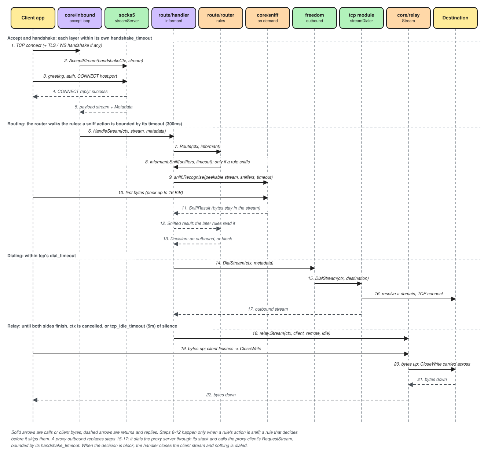
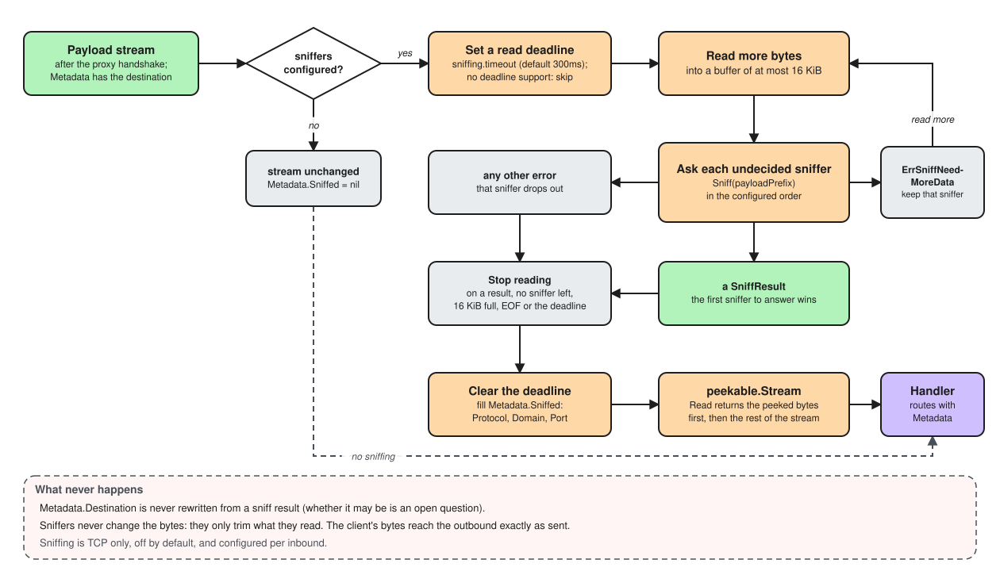

# Request lifecycle

Real traffic through the code: one TCP connection through a SOCKS5 inbound and
freedom, one UDP session from SOCKS5 UDP ASSOCIATE, and the same through a
Trojan-over-TLS proxy. Every function named here exists.

## Startup

`cmd/apranik/cli/run.go` does the wiring:

1. `load` calls `registry.Default()` and `config.LoadFile`, which parses the file
   into a `blueprint.Blueprint` and checks it.
2. `serve` creates a `builder.Builder`, which starts logging.
3. `BuildOutbound` builds each outbound: `outbound.NewFreedom` or
   `outbound.NewStream`.
4. `BuildRouter` loads the datasets and compiles the rules once; one router serves
   every inbound.
5. `BuildInbound` builds each inbound, and `Activate` starts it with a handler.

## One TCP connection

Step by step:

1. **Accept.** `streamInbound.acceptLoop` (`core/inbound/inbound.go`) accepts,
   takes a `max_tcp_connections` slot and starts `handleStream` in a goroutine.
2. **Overlays.** `wrapServerOverlays` runs each overlay's `WrapServerStream` in
   stack order (TLS, then WebSocket), each under its own `handshake_timeout`. An
   overlay that learns the real client replaces `Source` in the
   `spec.TransportMetadata`. A failure closes the connection.
3. **Proxy handshake.** The proxy server's `AcceptStream` (for SOCKS5,
   `module/proxy/socks5/server.go`) authenticates, reads the destination and returns
   the payload stream with its `Metadata`. A protocol that also carries UDP is
   first asked `IsDatagramOverStream`, which only peeks. A refusal with
   `spec.ErrFallbackRequested` replays the bytes to the inbound's `fallback` instead.
4. **Route.** `Handler.HandleStream` (`core/route/handler`) wraps the stream in an
   `informant.Stream` and calls `Router.Route`, which returns a `Decision`: an
   outbound, or block.
5. **Sniff, when a rule asks.** Only then is the stream made a `peekable.Stream`;
   `sniff.Recognise` peeks under a read deadline, and the peeked bytes are relayed
   later. The result fills `Metadata.Sniffed`; the destination never changes.
6. **Dial.** `freedomOutbound.DialStream` hands the destination to `tcp`, which
   resolves a domain through `core/dns` and dials with Happy Eyeballs. A proxy
   outbound dials its server instead and calls the client's `RequestStream`: here
   the address stops meaning the destination and starts meaning the proxy.
7. **Relay.** `relay.Stream` (`core/relay`) copies both ways and half-closes the
   far side when one side ends. Cancellation or `tcp_idle_timeout` closes both.

Sniffing in detail:

## One UDP session (SOCKS5 UDP ASSOCIATE)

Step by step:

1. **Hand-off.** SOCKS5's `AcceptStream` returns
   `spec.ErrUDPAssociationRequested`; `handleUDPAssociate` calls `Associate`, which
   opens the second socket through the `spec.UDPAssociateSocketFunc` core granted.
2. **Lifetime.** A goroutine reads the control stream; when it closes, the UDP
   session ends.
3. **Session.** `Handler.HandleDatagram` creates a `session.Session` and a routing
   cache, then runs `relay.Datagrams`.
4. **Client to destination.** Each packet's destination is routed once and the
   decision cached, block included. `Session.Send` writes it; a packet that cannot
   be routed or sent is dropped and the session goes on.
5. **Outbound datagram.** The first send through an outbound calls its
   `CreateDatagram`; for freedom, `nat.New`, which opens sockets as its mapping
   policy says.
6. **Replies.** Replies from every outbound datagram merge into one channel and go
   back to the client, under the domain the client used.
7. **End.** The client closes, or `udp_session_idle_timeout` passes in silence.
   Freedom's NAT sockets close after `nat.idle_timeout`.

## Through a proxy outbound over TLS

On the client, a Trojan-over-TLS outbound replaces the dial:

1. `streamOutbound.DialStream` (`core/outbound/proxy.go`) calls the dialer the
   builder folded from the stack: TCP, then the TLS client's `WrapClientStream`.
2. The Trojan client's `RequestStream` returns at once; the request leaves with the
   first payload, or alone after `proxy_request_timing.max_delay`.
3. On the server, TLS's `WrapServerStream` runs in the connection's goroutine, and
   Trojan's `AcceptStream` checks the password and reads the destination. The rest
   is the same as above.

For UDP, `CreateDatagram` makes the same dial and calls
`RequestDatagramOverStream`, so the whole UDP session is framed in one stream. An
outbound whose protocol cannot frame UDP, such as SOCKS5, lists only `tcp` in
`Networks()`, and UDP routed to it is dropped.
