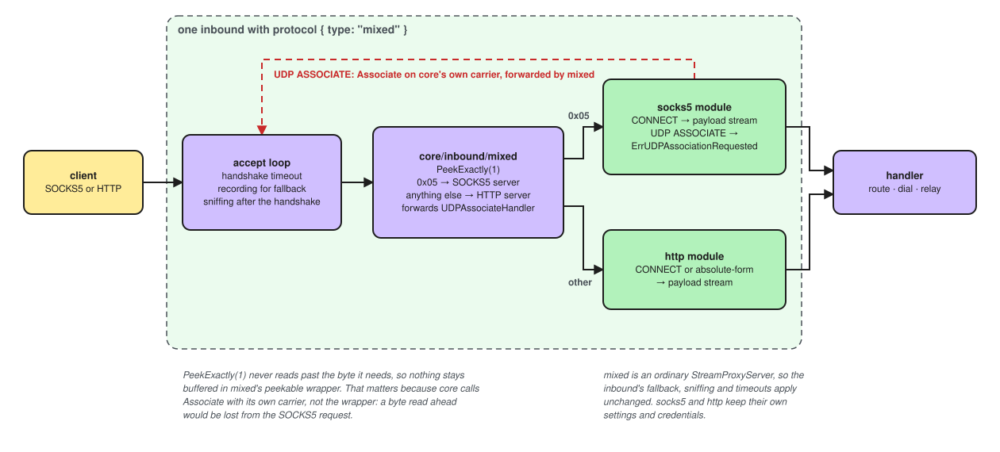

# Mixed

SOCKS5 and HTTP on one port. A connection whose first byte is `0x05` goes to
SOCKS5, anything else to HTTP. Built by core, not a module.

[](../../assets/diagrams/mixed-dispatch.excalidraw.svg)

## Structure

<div class="cfg-structure" markdown>

```json
{
  "tag": "mixed-in",
  "listen": "127.0.0.1",
  "port": 2080,
  "transport": [{ "type": "tcp" }],
  "protocol": {
    "type": "mixed",
    "settings": {
      "users": [{ "name": "alice", "password": "correct horse" }],
      "socks5": { "udp_relay": true },
      "http": {},
      "first_byte_timeout": "10s"
    }
  }
}
```

</div>

The other keys are those of every [inbound](index.md).

<div class="cfg-fields" markdown>

## Fields

### `users`

<span class="cfg cfg-type">list of users</span>

One list for both protocols, each user with a `name` and a `password`. A user must suit both, so a
name with `:` (HTTP) or over 255 bytes (SOCKS5) is refused. With none, no login is
asked. See [Users](users.md).

### `socks5`

<span class="cfg cfg-type">object</span>

[SOCKS5 inbound settings](../protocol/socks5.md#inbound-fields), without `users`.

### `http`

<span class="cfg cfg-type">object</span>

[HTTP inbound settings](../protocol/http.md#inbound-fields), without `users`.

### `first_byte_timeout`

<span class="cfg cfg-type">duration</span>
<span class="cfg cfg-def">Default: <code>10s</code></span>

How long a client may take to send its first byte. Then the chosen protocol's own
`handshake_timeout` applies.

</div>

SOCKS4 is not supported: its first byte goes to HTTP, which refuses it.
