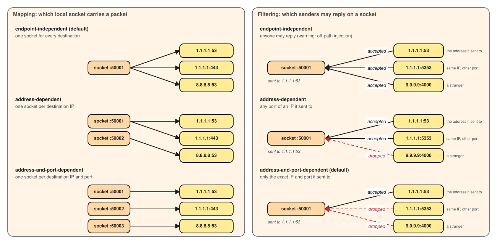

# Freedom

Sends each connection straight to its destination, over TCP and UDP. Built by
core, not a module. It takes `tag`, `transport` and `protocol` only; destinations'
names are resolved by the [resolver](../dns/index.md).

## Structure

<div class="cfg-structure" markdown>

```json
{
  "tag": "direct",
  "transport": [
    {
      "type": "tcp",
      "settings": { "keep_alive": "15s", "dial_timeout": "10s" }
    },
    { "type": "fragment" }
  ],
  "protocol": {
    "type": "freedom",
    "settings": {
      "nat": {
        "mapping": "endpoint-independent",
        "filtering": "address-and-port-dependent",
        "max_datagram_size": 8192,
        "idle_timeout": "5m"
      }
    }
  }
}
```

</div>

<div class="cfg-fields" markdown>

## Fields

### `transport`

<span class="cfg cfg-type">list of transports</span>
<span class="cfg cfg-def">Default: <code>[{ "type": "tcp" }]</code></span>

How TCP connections reach each destination: [`tcp`](../transport/tcp.md), then only
transports that need nothing on the far side, such as
[`fragment`](../transport/fragment.md). `tls` or `ws` would reach the destination
as garbage, so `check` refuses them.

### `udp`

<span class="cfg cfg-type">object</span>

[`udp` transport](../transport/udp.md) settings for the UDP sockets. None exist yet.

### `nat`

<span class="cfg cfg-type">object</span>

How UDP behaves as a NAT, in RFC 4787 terms.

### `nat.mapping`

<span class="cfg cfg-type">string</span>
<span class="cfg cfg-def">Default: <code>endpoint-independent</code></span>

When a UDP session gets a new socket: `endpoint-independent` (one for every
destination), `address-dependent` (one per IP) or `address-and-port-dependent`
(one per IP and port).

### `nat.filtering`

<span class="cfg cfg-type">string</span>
<span class="cfg cfg-def">Default: <code>address-and-port-dependent</code></span>

Who may reply: `address-and-port-dependent` (only the exact address sent to),
`address-dependent` (any port of that IP) or `endpoint-independent` (anyone).

> [!WARNING]
> `endpoint-independent` lets an off-path sender inject packets into a session.

### `nat.max_datagram_size`

<span class="cfg cfg-type">integer, bytes</span>
<span class="cfg cfg-def">Default: <code>8192</code></span>

The largest reply passed on; a larger one is dropped and counted. Match the
inbound's [`udp_max_datagram_size`](../inbound/index.md#udp_max_datagram_size).

### `nat.idle_timeout`

<span class="cfg cfg-type">duration</span>
<span class="cfg cfg-def">Default: <code>5m</code></span>

Closes a UDP socket silent for this long.

</div>

[](../../assets/diagrams/nat-behaviours.excalidraw.svg)
