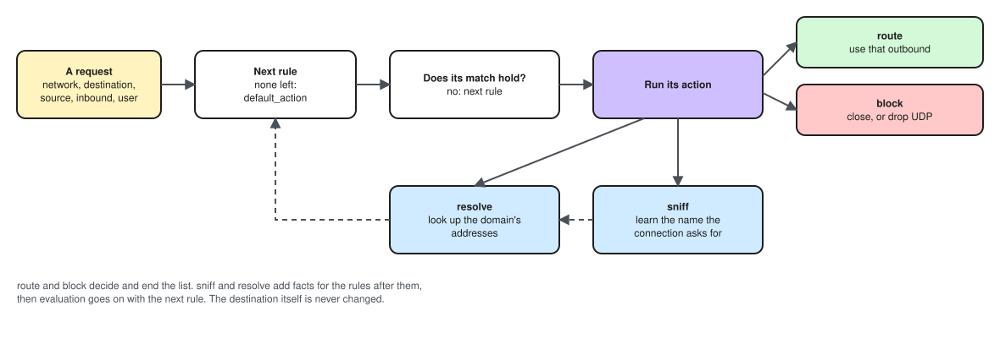

# Routing

Routing decides where each request goes: to an outbound, or nowhere. Rules are
checked in order; the first rule whose action decides wins, and
`default_action` serves every request no rule decided.

[](../../assets/diagrams/routing-evaluation.excalidraw.svg)

## Structure

<div class="cfg-structure" markdown>

```json
{
  "routing": {
    "datasets": [],
    "rules": [
      {
        "match": { "domain_suffix": ["ir"] },
        "action": { "type": "route", "settings": { "outbound": "direct" } }
      }
    ],
    "default_action": { "type": "route", "settings": { "outbound": "proxy" } }
  }
}
```

</div>

Without a `routing` section, every request takes the **first** outbound, and
`apranik check` warns when there are more. With one, `default_action` is
required.

<div class="cfg-fields" markdown>

## Fields

### `datasets`

<span class="cfg cfg-type">list of datasets</span>

Named lists of domains or IP ranges, read from files, that rules look up. See
[Datasets](datasets.md).

### `rules`

<span class="cfg cfg-type">list of rules</span>

Each rule is a [`match`](#match) and an [`action`](#actions). Rules are
checked in order.

### `default_action`

<span class="cfg cfg-type">action</span>
<span class="cfg cfg-req">Required</span>

What happens to a request no rule decided: [`route`](#route) or
[`block`](#block).

</div>

## Match

A `match` holds conditions. **Different fields must all hold; the values of
one field are alternatives.** An empty `match` (`{}`) matches every request.

```json
{ "network": "tcp", "port": [80, 443] }
```

matches TCP to port 80 or 443.

### Logic

| Field | Format | Holds when |
| --- | --- | --- |
| `any` | list of matches | at least one of them holds |
| `all` | list of matches | every one of them holds |
| `not` | match | it does not hold |

They nest to any depth:

```json
{
  "network": "tcp",
  "any": [{ "domain_suffix": ["ir"] }, { "ip_in_dataset": ["ir-ips"] }],
  "not": { "port": [22] }
}
```

### The request

| Field | Format | Compares |
| --- | --- | --- |
| `inbound` | list of tags | the inbound the request arrived on |
| `network` | `"tcp"` or `"udp"` | the network |
| `user` | list of names | the user a proxy protocol authenticated, such as a Trojan user's `name` |
| `sniffed_protocol` | list of names | what a [`sniff`](#sniff) action recognised: `tls`, `http` |
| `sniffed_request_header` | object, header name → regex | headers of a sniffed HTTP request (below) |
| `sniffed_browser_family` | list of `chromium`, `firefox`, `safari` | the browser a sniffed TLS ClientHello looks like (below) |

`sniffed_request_header` holds when **every** header it names is present and
its value matches the Go regular expression: `{"user-agent": "^curl/",
":method": "^POST$"}`. Names are compared lowercase. Besides the request's
headers, the `http` sniffer reports `:method` and `:path`, the HTTP/2-style
names Xray's `attrs` uses. A header sent twice is one value, joined with
`", "`. To require only that a header exists, give it the pattern `""`.

`sniffed_browser_family` is a **guess** the `tls` sniffer makes from the
extensions in the ClientHello: `chromium` (Chrome, Edge, Brave, other
Chromium-based browsers), `firefox` or `safari` (Safari, and every browser on
iOS, which must use Apple's TLS stack). It is checked against every uTLS
preset, so a client imitating a browser is reported as that browser. It is
not proof of anything. When the sniffer is unsure, as with old browsers,
libraries and command-line tools, it reports no family, and no value of this
field matches. sing-box's `client` is the nearest field elsewhere; it reads
QUIC only.

### Domains

Domain fields read the **sniffed name** when a [`sniff`](#sniff) action found
one, and the destination's domain otherwise. This is what sing-box and Xray's
`routeOnly` do. The destination itself is never changed: the connection still
goes where the client asked. A request with neither name, such as one to an IP
that was not sniffed, never matches a domain field.

| Field | Format | Matches |
| --- | --- | --- |
| `domain` | list | exactly this name |
| `domain_suffix` | list | this name or any name under it: `google.com` matches `google.com` and `mail.google.com`, never `notgoogle.com`. A leading dot changes nothing. |
| `domain_keyword` | list | names containing it |
| `domain_regex` | list | names the Go regular expression matches |
| `domain_in_dataset` | list of dataset tags | names in a [domain dataset](datasets.md) |

Names are compared lowercase, without a trailing dot.

### Addresses and ports

The destination side has no prefix; the source side, the client, has
`source_`.

| Field | Format | Compares |
| --- | --- | --- |
| `ip` | list of addresses or CIDRs | the destination's IP: `"1.2.3.4"` or `"10.0.0.0/8"` |
| `ip_in_dataset` | list of dataset tags | the destination's IP, against an [IP dataset](datasets.md) |
| `ip_is_private` | boolean | whether the destination's IP is private or reserved (below) |
| `port` | list of numbers | the destination's port |
| `port_range` | list of `"first-last"` | the destination's port, inclusive: `"1000-2000"` |
| `source_ip` | list of addresses or CIDRs | the client's IP |
| `source_ip_in_dataset` | list of dataset tags | the client's IP, against an IP dataset |
| `ip_version` | list of `4`, `6` | the version of the destination's IP |
| `source_ip_is_private` | boolean | whether the client's IP is private or reserved |
| `source_port` | list of numbers | the client's port |
| `source_port_range` | list of `"first-last"` | the client's port, inclusive |
| `inbound_local_ip` | list of addresses or CIDRs | the IP of ours the client reached (below) |
| `inbound_local_port` | list of numbers | the port of ours the client reached |
| `inbound_local_port_range` | list of `"first-last"` | the port of ours the client reached, inclusive |

IP fields read only a destination that **is** an IP. A domain destination is
not resolved to match them, so it never matches `ip`, `ip_in_dataset`,
`ip_is_private` or `ip_version`. An IPv4 address written as IPv6
(`::ffff:1.2.3.4`) is version 4. Resolving for routing will come with the DNS subsystem.

The `inbound_local_` fields read the local end of the connection the client
opened: the address and port of this server it reached, where `source_` is
the client's end of the same connection. With an inbound listening on
`0.0.0.0:8443` on a server with two addresses, a client that connected to
`198.51.100.20:8443` matches `"inbound_local_ip": ["198.51.100.20"]`. It is
not the listen address, and not the address an outbound connects from. Xray
calls these `localIP` and `localPort`.

`ip_is_private` and `source_ip_is_private` need no dataset. It covers private, loopback, link-local,
multicast and unspecified addresses (what sing-box counts) and the reserved
IPv4 ranges Xray's `geoip:private` adds: `0.0.0.0/8`, `100.64.0.0/10`
(carrier-grade NAT, Tailscale), `192.0.0.0/24`, `192.0.2.0/24`,
`192.88.99.0/24`, `198.18.0.0/15`, `198.51.100.0/24`, `203.0.113.0/24` and
`224.0.0.0/3`.

## Actions

An action is `{"type": ..., "settings": {...}}`, the shape `protocol` and
`transport` use. `route` and `block` decide and end the rule list; `sniff`
does not, and the next rule is checked.

### `route`

```json
{ "type": "route", "settings": { "outbound": "direct" } }
```

Sends the request through the outbound with that tag.

### `block`

```json
{ "type": "block" }
```

Refuses the request. A TCP connection is closed; UDP datagrams to that
destination are dropped. It takes no settings.

### `sniff`

```json
{
  "type": "sniff",
  "settings": { "sniffers": [{ "type": "tls" }, { "type": "http" }], "timeout": "300ms" }
}
```

Reads the start of the connection to learn the name it asks for, then goes on
to the next rule, which sees the result. Rules before it see nothing sniffed.
Sniffing runs only when a request reaches this rule, so put rules that do not
need it, such as a port rule for SSH, before it. See [Sniffing](sniffing.md).

## Example

A client in Iran: Iranian sites and local addresses direct, ads blocked, QUIC
blocked so browsers fall back to TCP, everything else through the proxy.

```json
"routing": {
  "datasets": [
    { "tag": "ads",        "source": { "file": "geosite.dat" }, "format": { "type": "geodata", "kind": "domain", "category": "category-ads-all" } },
    { "tag": "ir-domains", "source": { "file": "geosite.dat" }, "format": { "type": "geodata", "kind": "domain", "category": "category-ir" } },
    { "tag": "ir-ips",     "source": { "file": "geoip.dat" },   "format": { "type": "geodata", "kind": "ip",     "category": "ir" } }
  ],
  "rules": [
    { "match":  { "inbound": ["mixed-in"], "network": "tcp" },
      "action": { "type": "sniff", "settings": { "sniffers": [{ "type": "tls" }, { "type": "http" }] } } },
    { "match":  { "domain_in_dataset": ["ads"] },
      "action": { "type": "block" } },
    { "match":  { "ip_is_private": true },
      "action": { "type": "route", "settings": { "outbound": "direct" } } },
    { "match":  { "any": [ { "domain_in_dataset": ["ir-domains"] }, { "ip_in_dataset": ["ir-ips"] }, { "domain_suffix": ["ir"] } ] },
      "action": { "type": "route", "settings": { "outbound": "direct" } } },
    { "match":  { "network": "udp", "port": [443] },
      "action": { "type": "block" } }
  ],
  "default_action": { "type": "route", "settings": { "outbound": "proxy" } }
}
```

## What `check` reports

Errors:

- an outbound, inbound or dataset tag that does not exist;
- a dataset used by a field of the other kind (an IP dataset in
  `domain_in_dataset`);
- a dataset file that is missing, or lacks the category, or holds the other
  kind of list;
- a regex, IP, CIDR or port range that does not parse, or an `ip_version`
  other than 4 or 6;
- a rule after one whose `match` is empty and that decides: it can never run;
- a `sniff` with no sniffers, or a `default_action` that sniffs.

Warnings:

- no `routing` section and more than one outbound;
- `sniffed_protocol`, `sniffed_request_header` or `sniffed_browser_family`
  read before any `sniff`;
- a `sniffed_browser_family` value no sniffer reports;
- a `sniff` that no later rule reads;
- a sniff `timeout` over 5 seconds;
- UDP routed to an outbound that cannot carry it.
