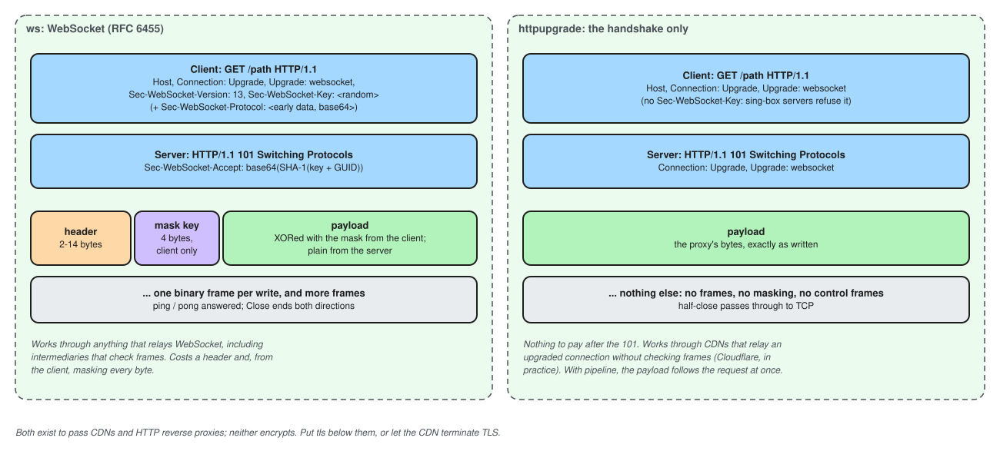

# HTTPUpgrade

An overlay: the HTTP/1.1 upgrade handshake, then raw bytes with no WebSocket
framing. It passes CDNs that relay an upgraded connection without checking frames,
such as Cloudflare, and costs nothing after the handshake. Compatible with Xray's
and sing-box's. A [`tls`](tls.md) below it must set `"alpn": ["http/1.1"]`.

[](../../assets/diagrams/ws-vs-httpupgrade.excalidraw.svg)

## Structure

=== "Inbound"

    ```json
    {
      "type": "httpupgrade",
      "settings": {
        "path": "/up",
        "host": "cdn.example.com",
        "accept_websocket_key": true
      }
    }
    ```

=== "Outbound"

    ```json
    {
      "type": "httpupgrade",
      "settings": { "path": "/up", "host": "cdn.example.com", "pipeline": false }
    }
    ```

<div class="cfg-fields" markdown>

## Fields

### `path`

<span class="cfg cfg-type">string</span>
<span class="cfg cfg-def">Default: <code>/</code></span>

The request path. A server ignores the query string and answers any other path
with `404`.

### `host`

<span class="cfg cfg-type">string</span>

Outbound: the `Host` header a CDN routes on; default the outbound's `server`.
Inbound: the only `Host` accepted; default any.

### `headers`

<span class="cfg cfg-type">object of strings</span>
<span class="cfg cfg-note">outbound</span>

Extra request headers. Without a `User-Agent`, a browser's is sent.

### `pipeline`

<span class="cfg cfg-type">boolean</span>
<span class="cfg cfg-def">Default: <code>false</code></span>
<span class="cfg cfg-note">outbound</span>

Send the payload without waiting for the server's `101`, saving a round trip. Only
safe against an Apranik server: Xray's and sing-box's may drop those bytes.

### `original_source_ip`

<span class="cfg cfg-type">object</span>
<span class="cfg cfg-note">inbound</span>

Reads the client's address from a header the CDN adds. See
[Client address behind a proxy](original_source_ip.md).

### `accept_websocket_key`

<span class="cfg cfg-type">boolean</span>
<span class="cfg cfg-def">Default: <code>true</code></span>
<span class="cfg cfg-note">inbound</span>

Accept a request carrying `Sec-WebSocket-Key`, as Xray does. `false` answers it
with `404`, as sing-box does.

### `handshake_timeout`

<span class="cfg cfg-type">duration</span>
<span class="cfg cfg-def">Default: <code>10s</code></span>

How long the upgrade may take.

</div>
